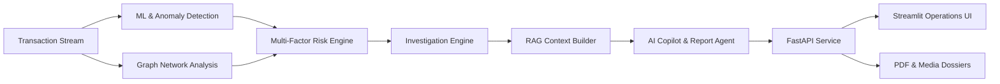

# AURA – Adaptive Unified Risk & Investigation Agent

[](https://www.python.org/)
[](https://fastapi.tiangolo.com/)
[](https://streamlit.io/)
[](LICENSE)

AURA is an enterprise-grade, AI-assisted fraud detection, investigation, and decision intelligence platform. It fuses machine learning, behavioral anomaly detection, graph intelligence, explainable AI (SHAP), retrieval-augmented generation (RAG), and agentic workflow orchestration.

---

## Key Features

- **Multi-Modal Risk Scoring**: Blends supervised ML (Random Forest, XGBoost) with unsupervised behavioral anomaly detection (Isolation Forest) and graph network metrics.
- **Graph Intelligence**: Traces shared merchant, customer, IP, and device networks to detect coordinated fraud rings and velocity spikes.
- **Explainable AI (XAI)**: Generates deterministic SHAP waterfall/feature contribution analysis for each flagged transaction.
- **RAG-Powered Fraud Copilot**: Uses domain-specific retrieval-augmented generation to provide context-grounded reasoning and policy compliance guidance.
- **Automated Report Generation**: Exports professional PDF investigation dossiers with ReportLab.
- **Interactive Operations Dashboard**: High-density analyst workbench built in Streamlit with real-time triage, transaction inspector, graph insights, and conversational copilot.
- **FastAPI Backend**: Microservice architecture exposing investigation, RAG, PDF export, and action-routing endpoints.

---

## Architecture Overview



---

## Project Structure

```
AURA-Fraud-Intelligence/
├── api/                   # FastAPI application & route controllers
├── configs/               # Application configuration schemas
├── dashboard/             # Streamlit operations cockpit
├── data/                  # Raw, processed, synthetic, and RAG data
├── database/              # Database models, schemas, and migrations
├── docs/                  # Technical documentation & project scopes
├── models/                # Trained ML models (Random Forest, Isolation Forest)
├── notebooks/             # Research, EDA, feature engineering, and model validation
├── scripts/               # Utility scripts & automated video assembly tools
├── src/                   # Core business logic
│   ├── agents/            # Action routing & executor agents
│   ├── graph/             # Graph network construction & analysis
│   ├── investigation/     # Deterministic investigation & AI investigator
│   ├── llm/               # LLM provider clients (Groq / OpenAI)
│   ├── pipeline/          # End-to-end investigation pipelines
│   ├── rag/               # Document chunker, retriever, and RAG pipeline
│   ├── reporting/         # PDF generation engine
│   ├── risk/              # Risk engine & multi-factor scoring
│   └── video/             # Investigation storyboard & video generator
└── tests/                 # Automated unit and integration test suite
```

---

## Quickstart

### 1. Environment Setup
```bash
# Clone the repository
git clone https://github.com/laraib275/AURA-Fraud-Intelligence.git
cd AURA-Fraud-Intelligence

# Activate virtual environment
# On Windows:
.venv\Scripts\activate
# On Linux/macOS:
source .venv/bin/activate

# Install dependencies
pip install -r requirements.txt
```

### 2. Configure Environment Variables
Copy `.env.example` to `.env` and configure your API keys:
```bash
cp .env.example .env
```
Ensure your `GROQ_API_KEY` is provided.

### 3. Start the Services

**Start the FastAPI Backend:**
```bash
uvicorn api.main:app --reload --port 8000
```

**Launch the Streamlit Cockpit:**
```bash
streamlit run dashboard/app.py
```

Open `http://localhost:8501` to access the fraud operations center.

---

## Disclaimer

This platform is an educational and research prototype developed using synthetic and public benchmark data. It is not connected to live financial rails or confidential banking systems.